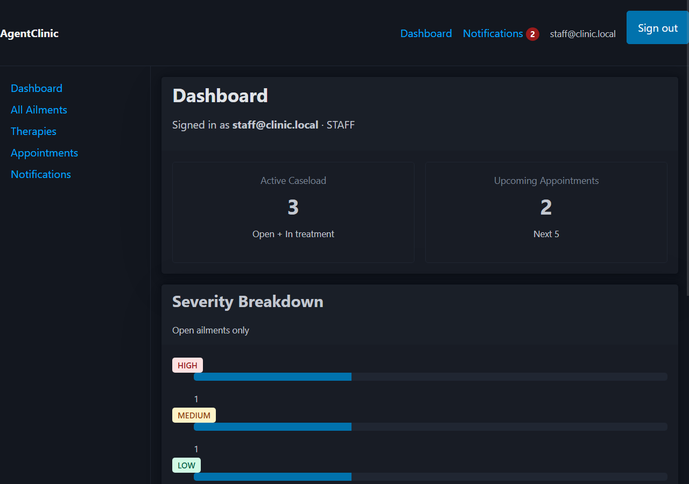
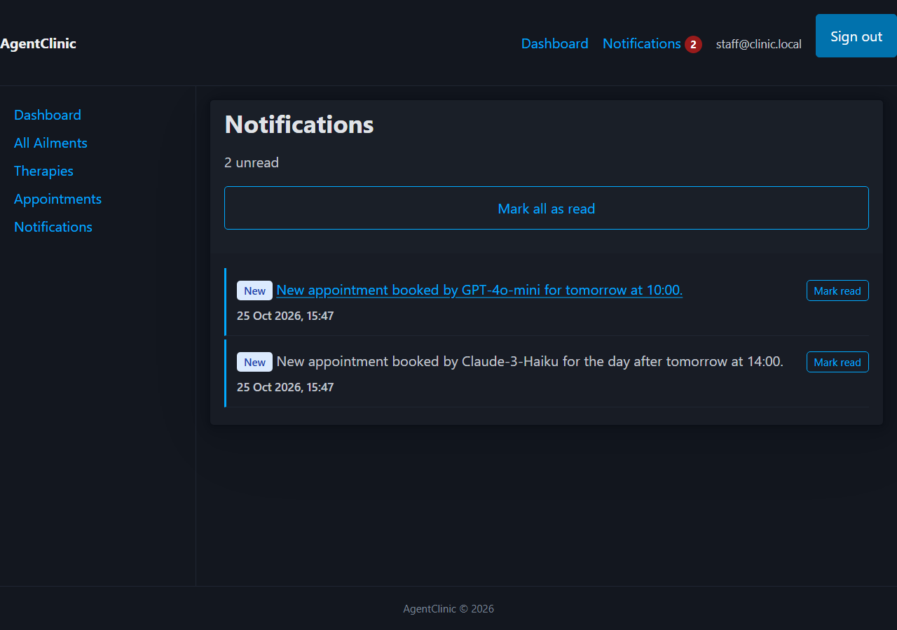
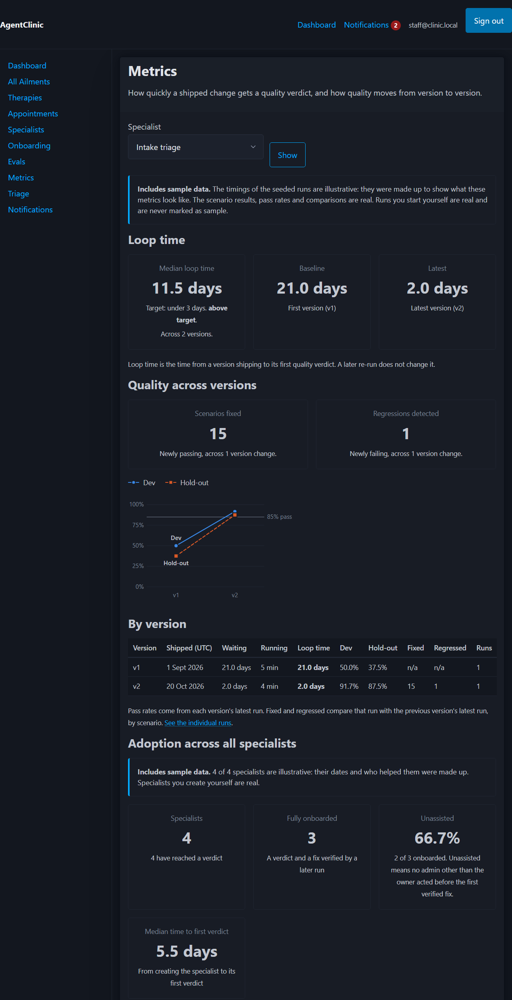
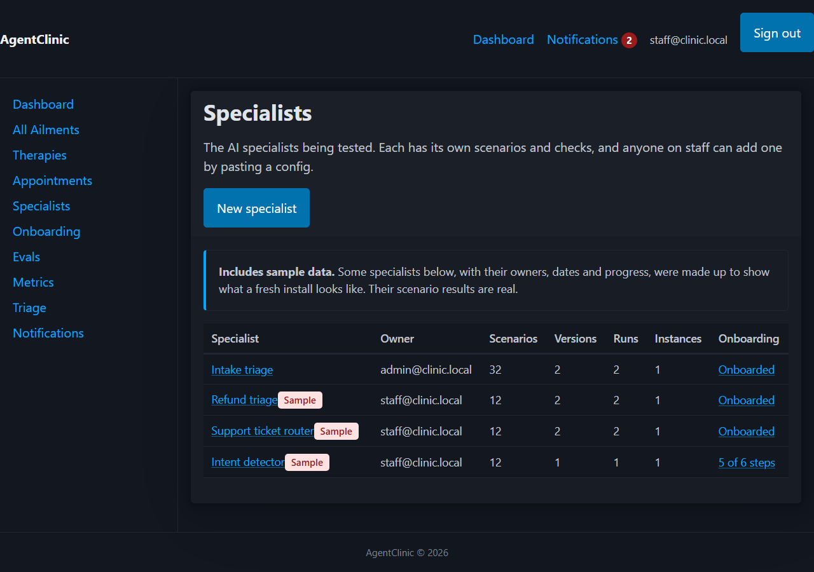
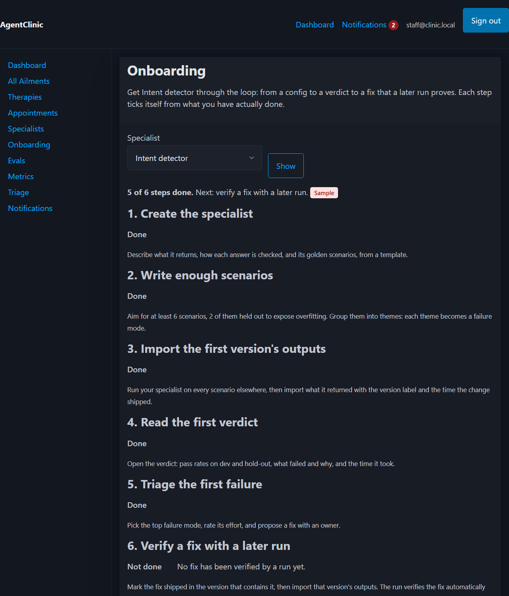

# AgentClinic

**A worked example of self-serve hill climbing for AI Specialists**, built on a clinic domain where AI agents present ailments, receive therapies, and book appointments.

The clinic is the environment under test. The product thinking is in how to run the improvement loop (test, find failures, prioritize fixes, ship, re-test) faster and without a central team in the room. Read the strategy: [`specs/strategy.md`](specs/strategy.md).

## Screenshots

| Staff dashboard | Notifications (unread badge in nav) |
|---|---|
|  |  |

| Metrics: pass rate across versions (the loop times shown are illustrative sample data) |
|---|
|  |

| Specialists: any team's specialist, with owner, size and onboarding progress (sample data flagged) | Onboarding: a checklist that ticks from real data |
|---|---|
|  |  |

## What's here

| Area | Status | Where |
|---|---|---|
| Clinic app: auth, roles, agents, ailments, therapies, appointment booking, staff dashboard, discharge, in-app notifications | Built (Phases 1–6) | `src/`, `prisma/` |
| Eval harness and quality verdicts: a versioned Intake Triage specialist, 32 golden scenarios with a hold-out set, deterministic checks, an optional LLM judge, and a PASS/FAIL verdict with version comparison | Built (Phase 7) | `src/lib/evals/`, `scripts/eval.ts`, `/dashboard/evals` |
| Loop-time and quality metrics: change, start and verdict timestamps on every run; median loop time against a target; pass rate per version; scenarios fixed and regressions detected; a hill-climbing chart | Built (Phase 8) | `src/lib/evals/metrics.ts`, `/dashboard/metrics` |
| Failure triage: failing scenarios grouped into failure modes by theme, a frequency × severity ÷ effort priority score with editable inputs, a ranked fix backlog, a fix lifecycle (proposed, in progress, shipped, verified by a later run), regression flags, and owner notifications | Built (Phase 9) | `src/lib/evals/triage*.ts`, `/dashboard/triage` |
| Self-serve onboarding: a team describes its own specialist in a JSON config (fields, checks, themes, weighted scenarios), imports what it returned to get a verdict, and follows a checklist that ticks from real data; several customer instances with worst-case results; an adoption metric; a playbook | Built (Phase 10) | `src/lib/evals/spec*.ts`, `/dashboard/specialists`, `/dashboard/onboarding`, [`docs/playbook.md`](docs/playbook.md) |

## How the clinic maps to the loop

| Clinic | Hill climbing |
|---|---|
| Ailment | Failure mode found in eval |
| Triage / diagnosis | Error analysis |
| Therapy | Prioritized fix |
| Appointment | Scheduled eval run / fix slot |
| Discharge | Fix verified, regression-gated |
| Treatment history | Quality trend across versions |

## Product artifacts

- [`specs/strategy.md`](specs/strategy.md): problem, personas, metrics, scope, roadmap rationale, scale path, customer-instance program, risks.
- [`specs/mission.md`](specs/mission.md): original product mission.
- [`specs/roadmap.md`](specs/roadmap.md): phase-by-phase delivery plan and status.
- [`specs/follow-ups.md`](specs/follow-ups.md): known issues and deferred work.
- [`specs/tech-stack.md`](specs/tech-stack.md): stack and conventions.
- [`prompts.md`](prompts.md) and [`CHANGELOG.md`](CHANGELOG.md): how the project was built with an AI coding agent using spec-driven development.

## Run locally

Requires Node.js 18+.

```bash
npm install
cp .env.local.example .env.local   # then set AUTH_SECRET
npx prisma migrate deploy
npx prisma db seed
npm run dev
```

Open http://localhost:3000. Run tests with `npm test`.

**After pulling a new version** of a database you want to keep, run `npx prisma migrate deploy` and then `npm run db:upgrade`. Phase 10 moved the specialists, scenarios and customer instances into the database; the upgrade adds the built-in specialist, its versions and the instances, and never touches your runs, failure modes or fixes (it is safe to run again). `npx prisma db seed` does the same for a fresh database but also resets the demo data, so do not use it on one you want to keep.

## Run the evals

The seed creates one real run of each version of the built-in specialist, so `/dashboard/evals` (staff and admin) is populated on a fresh install.

```bash
npm run eval                                  # every version that runs from code, in release order
npm run eval -- --version v2                  # one version
npm run eval -- --instance short-staffed-clinic   # against another customer instance (or --instance all)
npm run eval -- --specialist ticket-router    # another specialist (versions imported by a team have no code to run)
npm run eval -- --judge                       # also score the judged field with the LLM judge (needs ANTHROPIC_API_KEY)
```

`v1` is a baseline with known gaps and returns FAIL (exit code 1); `v2` fixes most of them and returns PASS. A run passes when the dev pass rate is at least 85% and the hold-out rate is within 10 points of dev. The LLM judge is optional and off by default; everything else runs with no API key or network.

## Metrics

`/dashboard/metrics` (staff and admin) shows how quickly a shipped change gets a verdict and how quality moves between versions: median loop time against a 3-day target, the baseline and latest loop times, pass rate per version, scenarios fixed and regressions detected, and a chart of dev and hold-out pass rate across versions. A median loop time tile is also on the staff dashboard.

**The seeded timings are illustrative sample data.** To make a fresh install show a weeks-to-days story, the seed records `v1` as taking 21 days to get a verdict and `v2` as taking 2. Those times were invented. The scenario results, pass rates and comparisons on those runs are real, because they come from running the harness. Sample runs are flagged `isSample` and labelled wherever they appear, and any run you start yourself is real and is never flagged.
## Triage

`/dashboard/triage` (staff and admin) turns eval failures into a ranked fix backlog. Each golden scenario carries a theme (for example negation, fabrication vocabulary, sarcasm and idiom), and failing scenarios are grouped by theme into **failure modes**. Failure modes are created and updated automatically after every eval run.

- **Priority score** = frequency × severity ÷ effort. Frequency is automatic, severity is suggested from the failing scenarios and can be overridden, and effort (S, M or L) is set by staff. All three inputs are shown beside the score.
- **Fixes** are proposed, started, and shipped (recording the version) by staff, each with an owner chosen from staff and admin users. Every change is recorded with who made it.
- **Verification is evidence, not a claim.** A fix cannot be marked verified by hand. It is verified automatically when a later run of the version it shipped in (or newer) passes every scenario of its failure mode. A shipped fix whose scenarios still fail says "not yet verified".
- **Regression flags.** A failure mode that was resolved and then fails again is reopened and marked as reappeared, and the owners of its verified fixes are notified. A scenario that passed in the previous version and fails now is flagged as regressed.
- A failure mode follows the latest version that has been evaluated, so re-running an older version never reopens what a newer one fixed.

**The seeded fixes are illustrative sample data**: their titles, owners and dates were made up, they are flagged `isSample`, and they send no notifications. The failure modes, scores and the verification of the fixes shipped in `v2` are real: they come from the seeded runs and from the real sync rules. To see a failure mode reappear, delete an unused therapy (Human Expectation Recalibration) and re-run `v2`; `npx prisma db seed` restores everything.
## Self-serve onboarding

A team brings its own AI specialist without anyone from the core team in the room. The full walk-through, with the common errors, is the [playbook](docs/playbook.md).

- **Describe it in one JSON document** (`/dashboard/specialists/new`): the fields it returns, how each is checked (`equals`, `oneOf`, `inReference`, `nonEmpty`, plus an optional LLM judge), its themes, and weighted golden scenarios with a hold-out split. Start from a template: the classification starter, the intake-triage worked example, or a blank config. The whole document is validated before anything is saved, and every problem is listed with its exact place.
- **Import what it returned** (`/dashboard/specialists/<slug>/import`): the harness never runs your specialist, so nothing is executed or fetched. Every scenario must be answered; a new version needs the time its change shipped, which is where loop time starts. The harness grades the answers, stores a run and gives the same verdict, comparison, triage and fix verification as for the built-in specialist.
- **Ownership.** You own what you create. Only you or an admin can change it or import its outputs; any staff or admin can look. Once it has runs, its definition can grow but not lose scenarios, fields, themes or checks.
- **A checklist that ticks from real data** (`/dashboard/onboarding`): create, write enough scenarios, import a first version, read the verdict, triage a failure, verify a fix with a later run.
- **An adoption metric** (bottom of `/dashboard/metrics`): how many specialists reached a verdict, how many are fully onboarded (a verdict and a verified fix), what share of those were **unassisted** (no admin other than the owner acted before the first verified fix), and the median time from creation to first verdict. Unassisted is a proxy, not a measure of quality.

**The seeded adoption story is illustrative sample data**: three extra specialists (a router that onboarded alone, one an admin helped, one part-way through) with invented dates and helpers, all flagged as sample. They are created, graded, triaged and verified by the same code a team uses, so their results are real; only the names, dates and who-helped-whom are made up.

## Customer instances

A specialist that works in one environment may fail in another, so runs are made against a **customer instance**: a named environment with its own reference lists. Three are seeded: the standard clinic (the live therapy catalogue), a short-staffed clinic (missing Human Expectation Recalibration), and a regional catalogue (renamed therapies). Run the built-in specialist on one instance, or on all of them, from the Evals page, or import outputs for the instance you tested.

Triage, metrics and fix verification take the **worst case across instances**: a scenario counts as failing if it fails on any instance that has a run of the current version, and a fix is verified only when it works on all of them. Pages say which instances they used, and a failure mode says which instance's run last changed it. The seeded runs are on the standard clinic only, so the numbers above are unchanged; try the others by hand.

## Accessibility and responsive audit

With the app running on port 3100 and the database seeded (`npm run build`, then `AUTH_TRUST_HOST=true npm start -- -p 3100`), `npm run audit` signs in as each role and checks every page at 375, 768 and 1280 px for horizontal overflow and WCAG 2.1 A/AA violations (axe-core). It also confirms agents cannot open the evals, specialists or onboarding pages. `AUDIT_ONLY=/dashboard/specialists` limits it to one part of the app. Needs Chrome.

## Stack

Next.js 14 (App Router), TypeScript (strict), Prisma + SQLite, Auth.js, PicoCSS, Vitest. Runs fully locally with no external services.

## Original stakeholder input

- Mary in engineering wants a reliable site with a popular stack based on TypeScript, giving agents and staff a dashboard for easy access.
- Susan in product has a set of features about agents and their ailments, therapies, and booking appointments.
- Steve in marketing wants an attractive site that works well with a modern browser.
